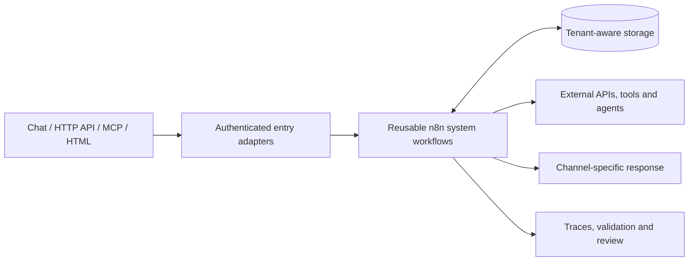

# n8n Engineering System

**An n8n-native systems framework:** treat n8n as the visual language of application behavior, with agents assembling reusable workflows, integrations, state, and interfaces rather than starting each system from conventional application code.

> n8n is technically a workflow automation platform. The language analogy describes our approach; this repository is a research/design baseline, not an implemented application framework.

## Decisions closed — 15 November 2026

The [executive decision record](docs/strategy/executive-decisions-2026-11-15.md) consolidates the agreed **product direction**, **human-facing abstraction**, **official SDK / Skills / MCP foundation**, **n8n-native reuse**, and **safe release boundaries**.

**Our commitment:** build a **spec-driven n8n systems framework** *on top of n8n's official tools*, not another workflow SDK or a generic agent-chat UI. The user specifies outcomes, the agents assemble/test the implementation, and the default interface shows what the system actually does through verified business-level boxes.

**Next milestone:** one version-pinned SDK-first reference system, generated from a product spec, tested on isolated n8n staging, with its visual behavior map derived from real workflow artifacts. **Not built yet.** See [roadmap](docs/roadmap.md).

## The 2027 product-development thesis

**Build from a specification. Let agents handle implementation. Let humans understand the actual product through a visual map of its behavior.**

Our target user **wants to understand, but does not have time to learn all the underlying technologies**. They should see what triggers a system, what it decides, what it does, and what happens when something fails—not code diffs or raw agent tool transcripts by default.

| Abstraction | Human-facing representation |
|---|---|
| 1. Code | Files, functions and implementation diffs |
| 2. Agent conversations | Plans, instructions, tool calls and summaries |
| **3. Behavior-first UI (our default)** | **Business-level boxes, connections, decisions, outcomes and truthful status** |

These are complementary viewing levels, not a claim that technical detail becomes unnecessary. The default should show **exactly the context needed for the next decision, no more and no less**; deeper evidence remains available to authorized users.

~~~mermaid
flowchart TD
  SPEC["Human describes desired behavior"] --> AGENTS["Agents design, build and test"]
  AGENTS --> N8N["Versioned n8n workflows"]
  N8N --> MAP["Human sees behavior map"]
  N8N --> EVIDENCE["Runtime evidence and release status"]
  EVIDENCE --> MAP
  MAP -->|"Request improvement"| SPEC
~~~

**Example of what a customer-facing view might show** (illustrative; not a deployed system):

~~~mermaid
flowchart LR
  MSG["Message received"] --> ID["Identify customer"]
  ID -->|authorized| DATA["Retrieve information"]
  ID -->|denied| DENY["Explain access restriction"]
  DATA --> AI["Resolve request"]
  AI -->|resolved| REPLY["Send response"]
  AI -->|needs help| ESC["Escalate to human"]
~~~

Each box must be linked to the **real approved system version**, including its workflows, tests, and runtime evidence. A static agent-invented diagram is not acceptable evidence of implementation.

Read [Spec-driven product development](docs/framework/spec-driven-product-development.md), [Behavior-first visual interface](docs/framework/behavior-first-interface.md), and [ADR-0003](docs/decisions/0003-behavior-first-visual-abstraction.md).

## Our system-first model



The **system** is more than a workflow JSON: it includes identity, inputs/outputs, reusable capabilities, durable state, interface adapters, tests and a controlled release. Read the [framework overview](docs/framework/README.md) and the [system model](docs/framework/system-model.md). The [change in direction is recorded in ADR-0002](docs/decisions/0002-n8n-native-systems-framework.md).


> **Status:** Documentation baseline / research in progress. Not a production-ready n8n workflow generator or validated skill.
>
> **Research baseline:** n8n `2.47.7` (release 2026-11-13), commit [`d4dcb1b152a98fc31ea7c4ee6aecdc45c5c88063`](https://github.com/n8n-io/n8n/commit/d4dcb1b152a98fc31ea7c4ee6aecdc45c5c88063), checked 2026-11-14. Target deployment versions must be checked independently.

## Purpose

Build a source-grounded, version-aware **n8n-native systems framework** that enables agents to **design, assemble, explain, validate, test, review, and improve entire systems of workflows** without rediscovering n8n behavior on every client project. The original workflow JSON effort remains a core capability within the broader system model.

The intended product output is more than one JSON file: validated **workflow JSON + visual architecture + test evidence + release manifest**. n8n is the inspectable execution layer; MCP enables discovery/operations; research and engineering standards constrain generation; independent testing gates changes before release.

## What this repository is *today*

An auditable documentation and research baseline. It has early engineering *proposals* and confirmed source-code observations. It **does not** claim full n8n schema coverage, production deployment validation, or exhaustive reverse-engineering. A first-party n8n staging environment has not been exercised as part of this baseline.

## Start here

1. [Spec-driven product development](docs/framework/spec-driven-product-development.md): the 2027 thesis, user audience, and creation lifecycle.
2. [Behavior-first interface](docs/framework/behavior-first-interface.md): visual boxes, truthful states, progressive disclosure and fidelity tests.
3. [n8n-native framework](docs/framework/README.md): system model, interface boundaries, tenancy and state.
4. [Project charter](docs/vision.md): outcomes, product boundaries and non-goals.
5. [System architecture](docs/architecture/system-overview.md): components, trust and execution boundaries.
6. [Research methodology](docs/research/methodology.md) and [source registry](docs/research/source-registry.md).
7. [n8n internals](docs/research/n8n-2.47.7-internals.md) and [JSON contract](docs/contracts/workflow-json.md).
8. [Engineering rulebook](docs/standards/architecture.md): evidence-based design decisions.
9. [Quality gates](docs/testing/quality-gates.md) and [roadmap](docs/roadmap.md).
10. [AGENTS.md](AGENTS.md): operating rules for AI contributors.

## Directory map

```text
n8n-engineering-system/
  AGENTS.md                       Agent contribution rules
  docs/
    framework/                    Spec-driven development, visual UI, system model, interfaces and tenancy
    architecture/                 Agent/platform architecture
    contracts/                    Output and workflow JSON contracts
    research/                     n8n internals, provenance, tooling and methodology
    standards/                    Normative proposed engineering rules
    testing/                      Acceptance criteria and quality gates
    decisions/                    Architecture decision records (ADRs)
    backlog/                      Open questions and research tasks
  research/evidence-index.json    Machine-readable findings with statuses
  schemas/                        Reserved for versioned schema snapshots
  patterns/                       Reserved for parameterized, tested workflow recipes
  integrations/                   Reserved for connector-specific guidance
  validators/                     Reserved for the n8n validation implementation
  skills/                         Reserved for installable agent skills
  scripts/check_docs.py           Local documentation consistency check
  tests/                          Documentation-check tests; n8n runtime tests later
  artifacts/                      Empty until generated and verified
```

## Official n8n toolchain is the foundation

**Architectural decision [ADR-0004](docs/decisions/0004-adopt-official-n8n-skills-and-sdk.md):** We will build the **spec-driven systems framework on top of n8n's official Skills, Workflow SDK and authorized instance-level MCP**, not recreate the workflow SDK. The SDK-first approach is the preferred *candidate*, to be confirmed by benchmarking and staging tests.

~~~mermaid
flowchart LR
  SPEC["Product specification"] --> PLAN["System capability contracts"]
  PLAN --> BUILD["Official n8n Workflow SDK"]
  SK["Official n8n Skills"] --> PLAN
  SK --> BUILD
  MCP["Instance-level MCP"] --> BUILD
  BUILD --> J["n8n workflow JSON"]
  J --> QA["Validation + staging + review"]
  QA --> MAP["Evidence-backed behavior map"]
~~~

- [Official toolchain and setup](docs/framework/official-toolchain.md)
- [Official skills baseline and installation](skills/README.md)

**What we still build:** system specifications, architecture decisions, cross-workflow contracts, security/tenancy, deterministic quality gates, independent review, release governance and behavior-first presentation.

## Newly verified n8n building blocks (November 2026)

The research now identifies **official n8n skills**, a **typed Workflow SDK**, native **human review / send-and-wait**, **Execute Sub-workflow**, **Execution Data**, **multiple triggers**, and **verified community policy/approval nodes** as high-value design inputs. These are tools to evaluate, not evidence that our framework has implemented them.

- [Native primitives and community node audit](docs/research/n8n-native-primitives-and-community-2026-11.md)
- [Verified creators and builders ecosystem](docs/research/creator-and-builder-ecosystem-2026-11.md)
- [Human authorization and policy gate standard](docs/standards/human-approval-and-policy-gates.md)

**Implementation direction:** prefer the official typed SDK and skills for supported workflow construction, but benchmark against direct JSON and template adaptation before making that path mandatory.

## Ground rules

- **Do not equate JSON parsing with n8n importability or runtime correctness.** n8n itself separates structural checks from semantic/publish checks.
- **Pin every source** to a revision/version; label unsupported inferences and open questions.
- **Keep secrets out of exports.** n8n warns workflow exports can include credential names/IDs and request auth headers. Sanitize before sharing.
- **No direct client production edits by generative agents.** Stage, independently validate, review and require the configured release authorization.
- **Prefer reusable n8n nodes/sub-workflows** when the implementation remains legible and behaviorally correct; custom code is a justified exception, not a ban.
- **Treat template repositories as examples, not authority.** Import and execute representative patterns before approving them.

## Current deliverable status

| Deliverable | State |
|---|---|
| Repo skeleton and architecture plan | Documented |
| Spec-driven development and behavior-first UI contract | Documented concept; no working UI or projection engine |
| Version-pinned source and source registry | Documented |
| Initial workflow JSON semantics | Source-verified subset |
| Full node schemas and integration catalog | Not built |
| Pattern library with tested JSON | Not built |
| Deterministic n8n validator | Not built |
| Staging test harness | Not built |
| Installable expert skill | Not built |

## Verification

```bash
python3 scripts/check_docs.py
python3 -m unittest discover -s tests -v
```

These commands check **documentation consistency only**; they do not validate n8n workflow JSON.

## Sources and attribution

Every factual n8n statement should carry a source URL or evidence ID. See [evidence index](research/evidence-index.json) and [source registry](docs/research/source-registry.md). Third-party repositories are not vendored in this baseline; their licenses and reuse rights must be reviewed before copying content.