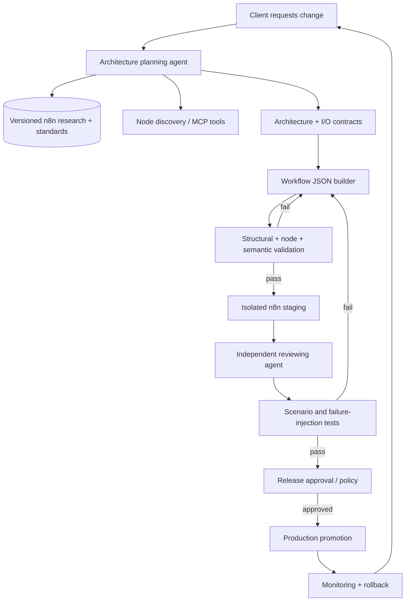

# Reference Architecture (Proposed)

## Control plane and execution plane

Mermaid is an architecture **proposal**; no parts of this pipeline are deployed by this repository.

## System components

| Component | Responsibility | Trust boundary |
|---|---|---|
| Requirement planner | Turn intent into constraints and contracts | Untrusted client input; must not directly call production writes |
| Research/evidence store | Supply version-pinned, cited technical facts | External docs, GitHub and community repositories are untrusted data |
| Node registry and MCP | Discover node operations and inspect instance capabilities | Scope permissions to the target non-production instance |
| JSON generator | Compose native node configurations and graph | No secrets in generated JSON; track source of every property |
| Structural validator | Check graph and minimum node shapes | Deterministic, version-matched checks |
| Semantic validator | Node presence, versions, expressions, parameter requirements | Must query the **actual target** node catalog |
| Staging runner | Execute with synthetic/sandbox data | Isolated credentials, test APIs and resource limits |
| Independent reviewer | Compare actual behavior with acceptance criteria | Separate from the generation agent; evidence-based decisions |
| Release controller | Policy, approval, version and rollback | Protected production permissions and audit log |

## Agent boundaries

The client-facing change-request agent may propose designs; it must not own the production deployment token. The builder gets controlled read/write access to staging. The reviewer gets the smallest permissions that let it inspect runs, submit test payloads and read evidence. The release controller is a separate authorization boundary, not a model message saying 'approved'.

## Environment separation

Use **development** for agent edits; **staging** for repeatable real executions and negative-case tests; **production** for approved versions. Avoid accidentally sharing live webhooks, production credentials, data stores or downstream side effects with staging. If n8n's licensed source-control feature is unavailable, establish an equivalent Git/CI + API process and test the exact API semantics.

## Critical state and concurrency risks

- Agent writes through MCP/Public API can overwrite concurrent UI changes. Require an edit lock, prior snapshot, version comparison and explicit conflict failure.
- A successful import is not a proof that a workflow can publish or execute.
- Publishing on a target instance is a separate lifecycle step from source-control push/pull.
- Retry semantics, external side effects and idempotency must be designed together.
- Workflow execution data may contain customer information; apply redaction and retention policies.

## References

- n8n source-control environments: https://docs.n8n.io/administer/use-source-control-and-environments/tutorial-create-environments-with-source-control.md
- n8n queue mode: https://docs.n8n.io/deploy/host-n8n/configure-n8n/scaling/enable-queue-mode.md
- n8n-MCP concurrency guidance: https://github.com/czlonkowski/n8n-mcp#working-safely-on-live-workflows
